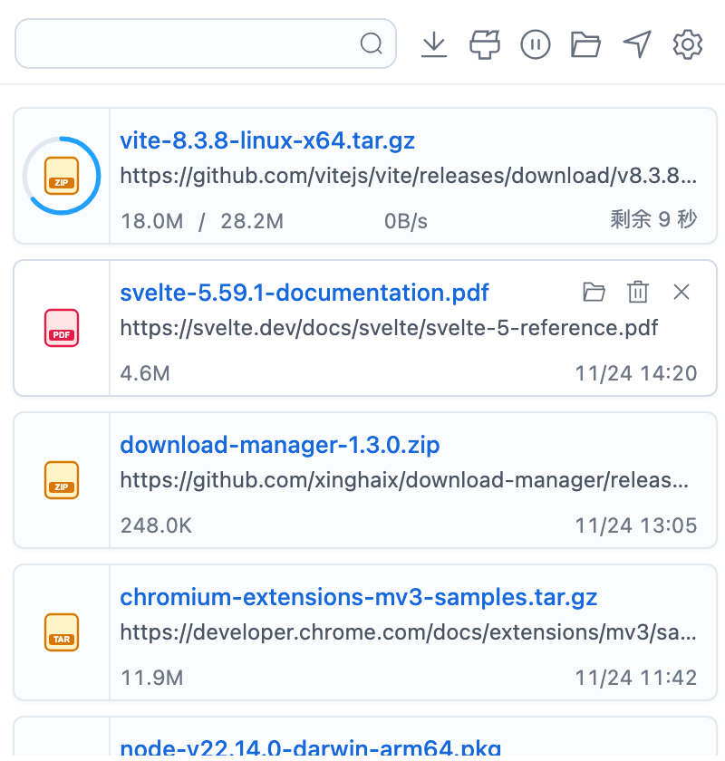
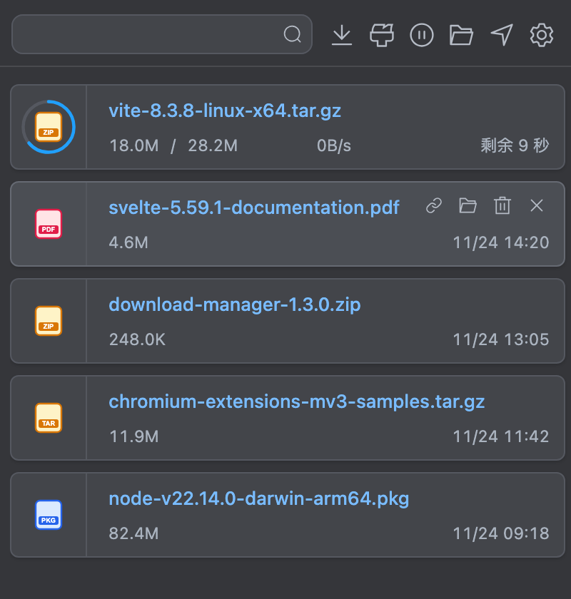
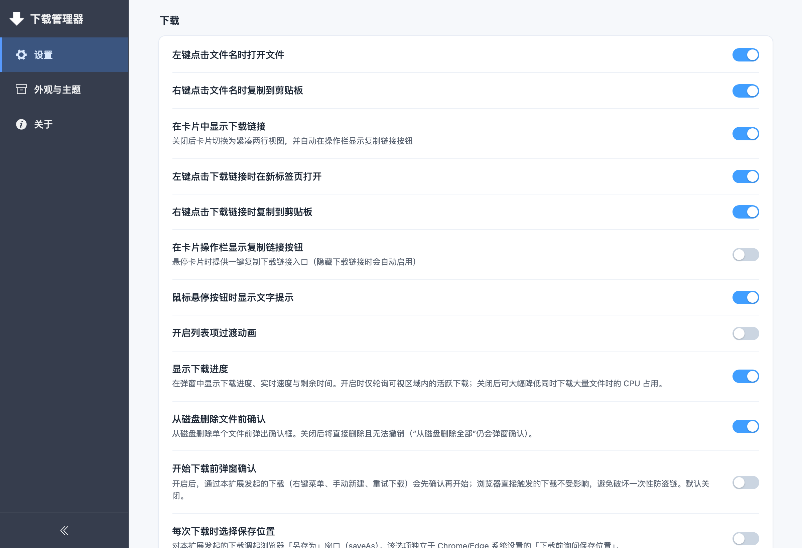
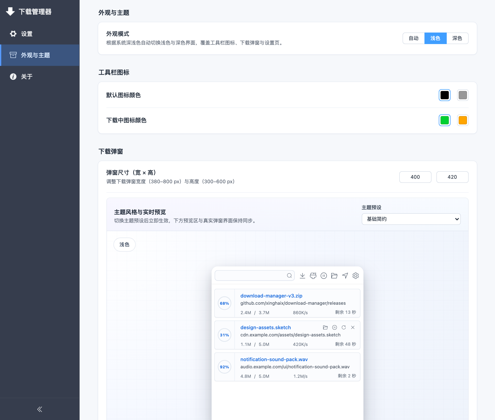

# **download-manager**

[](https://github.com/xinghaix/download-manager/actions/workflows/ci.yml)


[](https://github.com/xinghaix/download-manager/blob/master/LICENSE)

[](https://chrome.google.com/webstore/detail/ofpglhlcdbjdhlacgbljnildhajfmlei)
[](https://chrome.google.com/webstore/detail/ofpglhlcdbjdhlacgbljnildhajfmlei)
[](https://chrome.google.com/webstore/detail/ofpglhlcdbjdhlacgbljnildhajfmlei)

[](https://microsoftedge.microsoft.com/addons/detail/dppelgknofnkccigopomkbdedbkkcbgh)
[](https://microsoftedge.microsoft.com/addons/detail/dppelgknofnkccigopomkbdedbkkcbgh)
[](https://microsoftedge.microsoft.com/addons/detail/dppelgknofnkccigopomkbdedbkkcbgh)

适用于 Chromium 内核浏览器（Chrome / Microsoft Edge）的开源下载管理器扩展（Manifest V3 + Svelte 5）。点击工具栏图标即可集中管理全部下载任务，支持替代浏览器原生下载提示气泡。

### 1. 语言

**[简体中文](README.md) | [English](docs/README_EN.md)**

### 2. 下载安装

- [Chrome Web Store](https://chrome.google.com/webstore/detail/download-manager/ofpglhlcdbjdhlacgbljnildhajfmlei?hl=zh-CN)
- [Microsoft Edge Add-ons](https://microsoftedge.microsoft.com/addons/detail/dppelgknofnkccigopomkbdedbkkcbgh)
- [GitHub Releases（离线包）](https://github.com/xinghaix/download-manager/releases)

### 3. [隐私政策说明](docs/Privacy.md)

### 4. 支持功能

1. **实时进度与速率展示**：工具栏图标动态绘制下载总进度与任务角标，卡片内展示百分比环、已下载大小、实时速率与剩余时间（支持关闭进度轮询以降低大并发 CPU 占用）
2. **完整下载控制与批量操作**：单个任务支持打开文件、在文件夹中显示、暂停、恢复、取消、删除及重试；顶部支持「全部暂停 / 全部恢复 / 取消全部下载」及分类清理（清空列表、从磁盘删除全部、清除失败/不存在/已完成项）
3. **手动新建下载与实时搜索**：支持按文件名快速过滤（带一键清除按钮）及粘贴 URL 手动发起下载（回车提交）
4. **卡片链接显隐与快捷复制**：默认展示下载链接（支持左键打开 / 右键复制）；设置中可关闭链接行切换为 `58px` 紧凑两行视图，并自动在卡片操作栏显示「复制下载链接」按钮（亦可单独开启）
5. **安全下载与防误删保护**：危险下载确认（保留 / 舍弃）、从磁盘删除前确认，以及可选「开始下载前弹窗确认」与「每次下载时选择保存位置（`saveAs`）」
6. **网页右键菜单下载**：可按链接、图片、音频、视频独立开关右键快捷下载入口
7. **文件自动分类保存**：支持基于来源域名与文件扩展名规则自动保存到默认下载目录下的指定子文件夹（可调匹配优先级）
8. **桌面通知与本地提示音**：下载开始、完成、警告均支持独立开关通知与提示音，可设置通知停留时长、堆叠数量上限或常驻显示
9. **多主题风格与自定义外观**：全局支持跟随系统「自动 / 浅色 / 深色」外观，内置 Basic、GitHub、Claude、Terminal 四组浅深色主题预设与设置页实时预览，支持自定义工具栏图标颜色、弹窗尺寸、弹窗顶部快捷按钮显隐与拖拽排序
10. **快捷键与设置同步**：支持自定义打开弹窗快捷键（默认 `Alt+X`）；默认使用 `chrome.storage.sync` 同步个人偏好，可在设置页关闭以仅存储在本地，且不向第三方上传任何个人或下载数据

### 5. 支持的语言（19 种）

`English`、`简体中文`、`繁體中文`、`日本語`、`한국어`、`Deutsch`、`Français`、`Español`、`Español (Latinoamérica)`、`Italiano`、`Português (Brasil)`、`Nederlands`、`Polski`、`Русский`、`Українська`、`Türkçe`、`Bahasa Indonesia`、`Tiếng Việt`、`ไทย`

所有多语言文案位于 `public/_locales/*/messages.json`。如果您有更好的翻译建议，欢迎提交 Issue 或 Pull Request 参与改进。

### 6. 示例图

<table>
  <tr>
    <td align="center"><strong>浅色弹窗（完整视图）</strong></td>
    <td align="center"><strong>深色弹窗（隐藏链接紧凑视图）</strong></td>
  </tr>
  <tr>
    <td align="center"></td>
    <td align="center"></td>
  </tr>
  <tr>
    <td align="center"><strong>常规设置页面</strong></td>
    <td align="center"><strong>外观与主题实时预览</strong></td>
  </tr>
  <tr>
    <td align="center"></td>
    <td align="center"></td>
  </tr>
</table>

### 7. 编译打包

需要 **Node.js 22+**（构建工具链为 Vite 8 + Svelte 5，零运行时依赖）：

```bash
# 安装依赖
npm ci

# 代码检查
npm run lint

# 编译打包（输出至 dist/）
npm run build
```

### 8. 帮助与反馈

如有任何问题或功能建议，欢迎在 [GitHub Issues](https://github.com/xinghaix/download-manager/issues) 中提交反馈。
