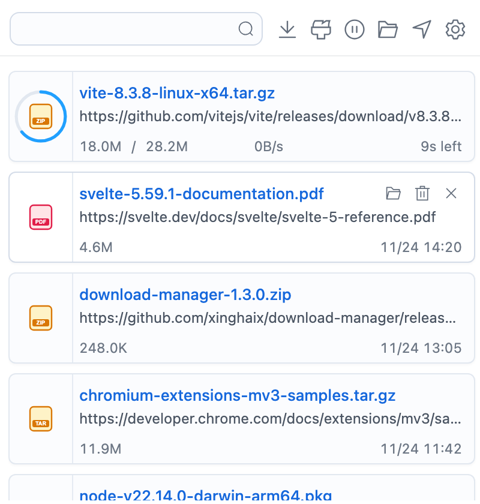
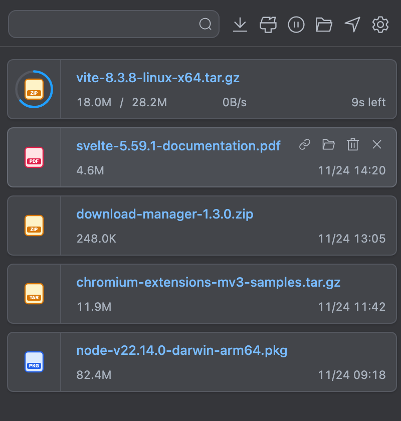
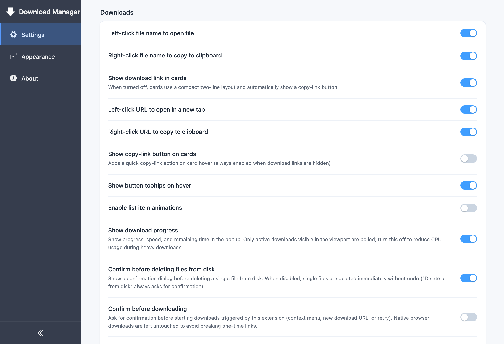
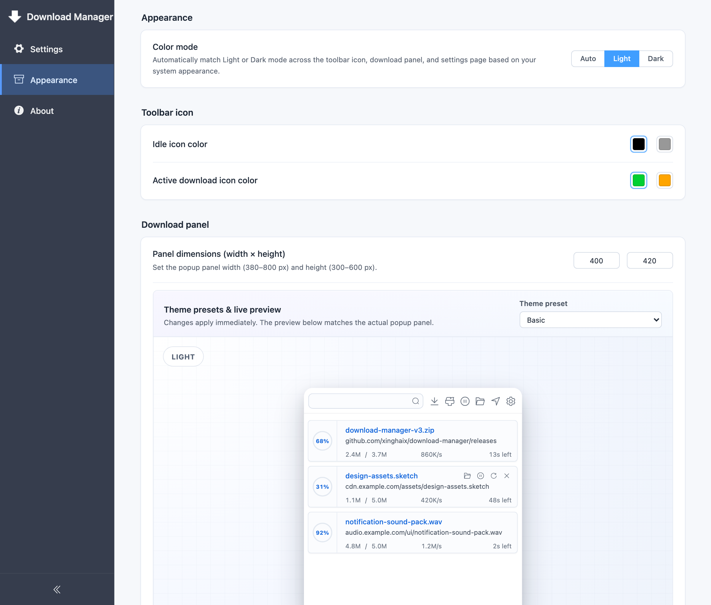

# **download-manager**

[](https://github.com/xinghaix/download-manager/actions/workflows/ci.yml)


[](https://github.com/xinghaix/download-manager/blob/master/LICENSE)

[](https://chrome.google.com/webstore/detail/ofpglhlcdbjdhlacgbljnildhajfmlei)
[](https://chrome.google.com/webstore/detail/ofpglhlcdbjdhlacgbljnildhajfmlei)
[](https://chrome.google.com/webstore/detail/ofpglhlcdbjdhlacgbljnildhajfmlei)

[](https://microsoftedge.microsoft.com/addons/detail/dppelgknofnkccigopomkbdedbkkcbgh)
[](https://microsoftedge.microsoft.com/addons/detail/dppelgknofnkccigopomkbdedbkkcbgh)
[](https://microsoftedge.microsoft.com/addons/detail/dppelgknofnkccigopomkbdedbkkcbgh)

An open-source Download Manager extension for Chromium-based browsers (Chrome / Microsoft Edge), built on Manifest V3 and Svelte 5. Click the toolbar icon to manage all downloads cleanly without native download shelf or bubble distractions.

### 1. Language

**[简体中文](../README.md) | [English](README_EN.md)**

### 2. Download

- [Chrome Web Store](https://chrome.google.com/webstore/detail/download-manager/ofpglhlcdbjdhlacgbljnildhajfmlei)
- [Microsoft Edge Add-ons](https://microsoftedge.microsoft.com/addons/detail/dppelgknofnkccigopomkbdedbkkcbgh)
- [GitHub Releases](https://github.com/xinghaix/download-manager/releases)

### 3. [Privacy Policy](Privacy_EN.md)

### 4. Features

1. **Real-Time Progress & Speed Tracking**: Dynamic toolbar icon progress ring and badge count, plus per-item percentage ring, transferred size, speed, and ETA (polling can be disabled to minimize CPU usage during heavy downloads)
2. **Full Download Controls & Batch Actions**: Open file, show in folder, pause, resume, cancel, delete, or retry individual downloads; top toolbar offers batch Pause/Resume/Cancel All and filtered cleanup (Clear list, Delete all from disk, Clear failed/missing/completed)
3. **Manual Download & Instant Search**: Filter downloads in real time (with quick clear button) and paste one or more URLs to start downloads manually
4. **Compact Card Mode & Quick Link Copy**: Display download URLs in cards (left-click to open, right-click to copy) or hide the URL row for a compact `58px` two-line layout with an automatic quick Copy Link icon button on hover
5. **Safety & Confirmation Controls**: Dangerous download review (`Keep` / `Discard`), optional delete confirmation, optional pre-download confirmation dialog, and optional "Save As" folder prompt (`saveAs`)
6. **Web Context Menu Downloads**: Toggle right-click quick download entries independently for Links, Images, Audio, and Video
7. **Automatic File Routing Rules**: Route downloads into subfolders under your default download directory by source domain or file extension with configurable rule precedence
8. **Desktop Notifications & Sound Alerts**: Independent toggles for Start, Complete, and Warning desktop notifications and local audio alerts, with configurable duration, stack limit, and persistent display
9. **Themes & Deep Customization**: Auto Light/Dark appearance across toolbar icon, popup, and options page; built-in Basic, GitHub, Claude, and Terminal theme presets with live preview; customizable toolbar icon colors, popup dimensions, and custom popup header button visibility and drag-and-drop order
10. **Keyboard Shortcut & Settings Sync**: Global popup shortcut (`Alt+X` by default); optional `chrome.storage.sync` preference sync (can be disabled for local-only storage), with zero third-party telemetry or data collection

### 5. Supported Languages (19 Locales)

`English`, `简体中文`, `繁體中文`, `日本語`, `한국어`, `Deutsch`, `Français`, `Español`, `Español (Latinoamérica)`, `Italiano`, `Português (Brasil)`, `Nederlands`, `Polski`, `Русский`, `Українська`, `Türkçe`, `Bahasa Indonesia`, `Tiếng Việt`, `ไทย`

All localization files are located in `public/_locales/*/messages.json`. Pull requests and issues with translation improvements are always welcome.

### 6. Screenshots

<table>
  <tr>
    <td align="center"><strong>Popup (Light · Full View)</strong></td>
    <td align="center"><strong>Popup (Dark · Compact View)</strong></td>
  </tr>
  <tr>
    <td align="center"></td>
    <td align="center"></td>
  </tr>
  <tr>
    <td align="center"><strong>Settings Page</strong></td>
    <td align="center"><strong>Appearance &amp; Theme Live Preview</strong></td>
  </tr>
  <tr>
    <td align="center"></td>
    <td align="center"></td>
  </tr>
</table>

### 7. Build & Package

Requires **Node.js 22+** (built with Vite 8 + Svelte 5 and zero runtime dependencies):

```bash
# Install dependencies
npm ci

# Run linter
npm run lint

# Build production extension into dist/
npm run build
```

### 8. Help

If you have any questions, bug reports, or feature ideas, please open an issue on [GitHub Issues](https://github.com/xinghaix/download-manager/issues).
